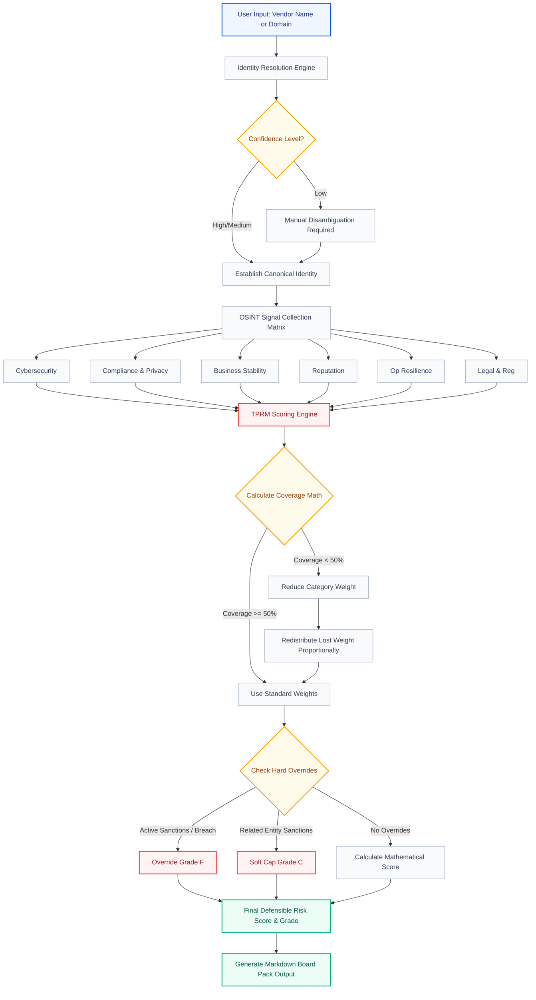

<div align="center">
  
</div>

<h1 align="center">Wahid AI: Third-Party Risk Management (TPRM) Scorer</h1>

<div align="center">
  <strong>Enterprise-Grade OSINT Telemetry & Vendor Risk Scoring Engine</strong>
</div>

<br />

<div align="center">
  
  
  
  
</div>

<br />

## 📖 Overview

The **Wahid AI Third-Party Risk Management (TPRM) Module** is a robust, dynamic React-based web application designed to evaluate vendor risk across a 20-point OSINT telemetry matrix. The system generates a highly defensible, mathematically rigorous vendor risk score (0-950) by analyzing publicly available data and user inputs.

Built with a pristine Light Theme UI featuring glassmorphism and modern enterprise aesthetics, the module acts as a complete "Real-Time OSINT Scanner" for any domain or vendor identity.

---

## 📊 The Scoring Model Matrix

The engine starts every vendor at a perfect "Pristine" score of **950**. Risk is penalized by subtracting points based on the severity of findings across 6 core categories.

| Category | Default Weight | Planned Signals | Example Signals |
|---|---|---|---|
| **Cybersecurity** | 30% | 6 | SSL Grade, Open Ports, security.txt, CVEs |
| **Compliance & Privacy** | 20% | 3 | Privacy Policy, DPA Availability |
| **Business Stability** | 15% | 3 | Bankruptcy Filings, Mass Layoffs |
| **Reputation** | 15% | 3 | Data Breach Disclosures, Negative News |
| **Operational Resilience**| 10% | 2 | Public Outages, Missing Status Page |
| **Legal & Regulatory** | 10% | 3 | Sanctions Matches, Regulatory Action |

### Severity Penalties
Findings deduct points from the category base score of 950:
- **Critical:** -150 pts
- **High:** -70 pts
- **Medium:** -30 pts
- **Low:** -10 pts
- **Informational:** 0 pts

### Hard & Soft Overrides
Certain extremely severe findings instantly override the mathematical model to protect the enterprise:
- **Direct Sanctions or Active Breach:** Overrides final score to Grade F.
- **Related-Entity / Partial Sanction Match:** Applies a soft-cap of Grade C (maximum score).

---

## 🏗️ System Architecture & Data Flow

Below is the complete end-to-end architecture of the Wahid AI TPRM Scoring Engine.



### Flow Diagram Explanation:
1. **Identity Resolution:** The user inputs a domain. The system verifies confidence and establishes a canonical vendor identity (e.g., matching "Effectiverm Inc" to `effectiverm.com`).
2. **OSINT Collection Matrix:** The system collects public telemetry and organizes it across the 6 major categories. This is where users flag specific severities.
3. **Coverage Math & Redistribution:** The engine checks if the vendor has "Insufficient Data" in any category (less than 50% of signals evaluated). If so, it mathematically reduces the weight of that category and intelligently redistributes the remaining weight proportion to the healthy categories.
4. **Hard Overrides:** The engine checks for Critical Global Events (like active ransomware or direct OFAC sanctions). If triggered, math is overridden.
5. **Final Outputs:** The mathematical score is outputted dynamically, generating the Defensible Risk Score (0-950) and a ready-to-export Markdown Board Pack.

---

## 🎯 Demo Walkthrough (`effectiverm.com`)

To demonstrate the platform, try recreating this demo scenario inside the live dashboard:

1. **Vendor Identity:** Enter `effectiverm.com`. The system resolves it to "Effectiverm Inc." with High confidence.
2. **Signal Assessment:** Navigate through the OSINT telemetry matrix and evaluate signals to 100% coverage.
3. **Trigger Cybersecurity Finding:** Flag the `security.txt` signal as a **Low (-10 pts)** finding.
4. **Trigger Operational Resilience Finding:** Flag a **Medium (-30 pts)** finding in the Op Resilience category.
5. **Final Math Breakdown:**
   - **Cybersecurity (30%):** 940 * 0.30 = 282
   - **Compliance (20%):** 950 * 0.20 = 190
   - **Business Stability (15%):** 950 * 0.15 = 142.5
   - **Reputation (15%):** 950 * 0.15 = 142.5
   - **Operational Resilience (10%):** 920 * 0.10 = 92
   - **Legal & Regulatory (10%):** 950 * 0.10 = 95
   **Final Defensible Score:** 282 + 190 + 142.5 + 142.5 + 92 + 95 = **944 / 950 (Grade A)**

---

## 🚀 Quick Start

### Prerequisites
*   Node.js (v16 or higher)
*   npm or yarn

### Installation

1.  **Clone the repository**
    ```bash
    git clone https://github.com/aamir-786/Osint-tprm-scorer.git
    cd Osint-tprm-scorer
    ```

2.  **Install dependencies**
    ```bash
    npm install
    ```

3.  **Start the development server**
    ```bash
    npm run dev
    ```

4.  **Open your browser** and navigate to `http://localhost:5173`.

---

<div align="center">
  <i>Built for the Wahid AI Enterprise Platform v3.4.1</i>
</div>