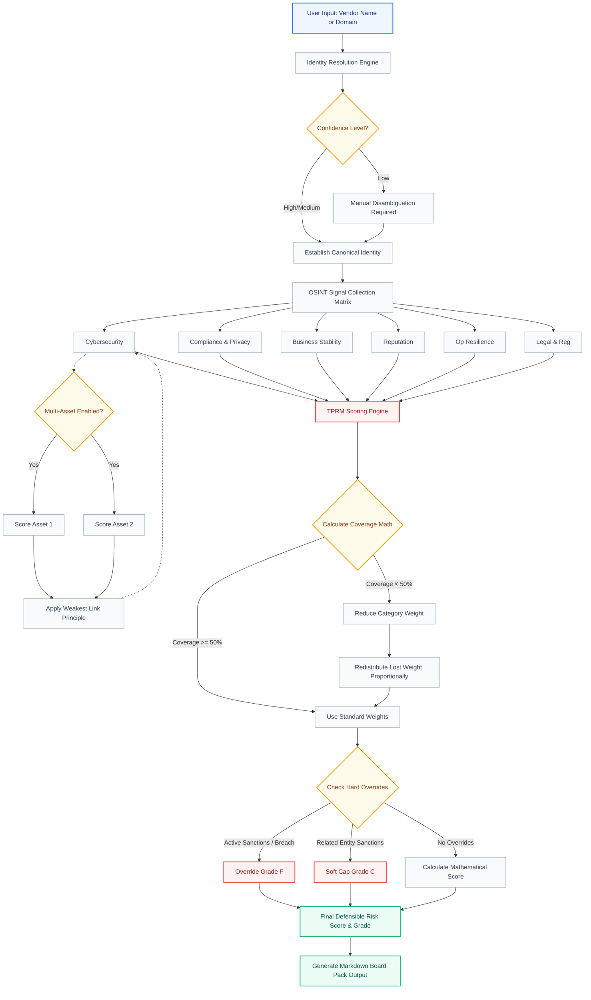
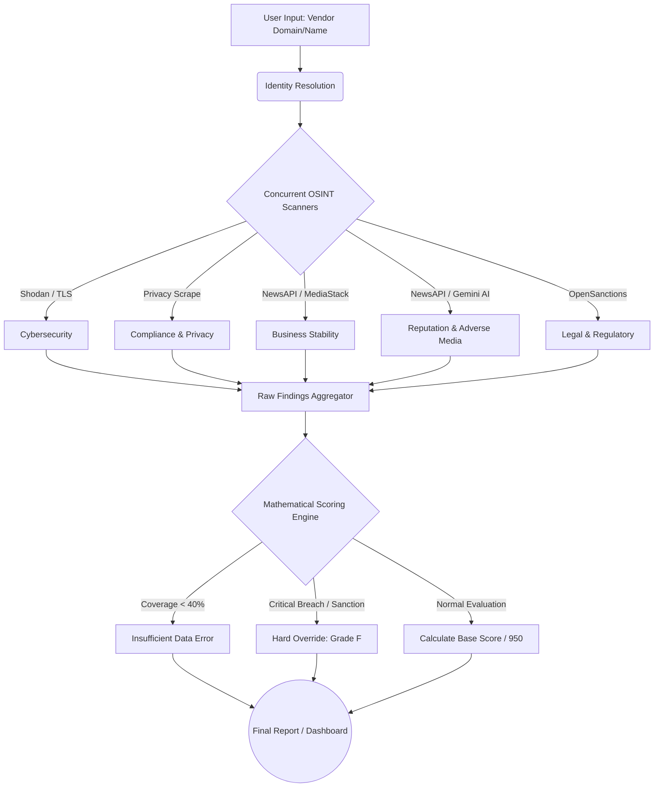

# Wahid AI TPRM Module - Demo Guide & Architecture Flow

This document provides a walkthrough of the TPRM Dashboard based on the `Effectiverm Inc.` demo scenario, explaining the data flow, architecture, and exact scoring mechanics observed.

## Demo Scenario: `effectiverm.com`
In this scenario, we evaluated a vendor with a pristine record except for two minor/medium operational and cybersecurity issues.

1. **Vendor Identity:** System resolved "Effectiverm Inc." to `effectiverm.com` with High confidence.
2. **Coverage:** All 6 categories had 100% coverage (all planned signals evaluated).
3. **Cybersecurity Findings:** 1 Low severity finding (Missing `security.txt` file). Score = 940 (-10 pts).
4. **Operational Resilience Findings:** 1 Medium severity finding. Score = 920 (-30 pts).
5. **Other Categories:** Pristine (950).
6. **Final Score:** 944 / 950 (Grade A).

### Mathematical Breakdown
Because all categories had >= 50% coverage, no weight redistribution occurred. The math strictly followed the base weights:
- **Cybersecurity (30%):** 940 * 0.30 = 282
- **Compliance (20%):** 950 * 0.20 = 190
- **Business Stability (15%):** 950 * 0.15 = 142.5
- **Reputation (15%):** 950 * 0.15 = 142.5
- **Operational Resilience (10%):** 920 * 0.10 = 92
- **Legal & Regulatory (10%):** 950 * 0.10 = 95
**Total:** 282 + 190 + 142.5 + 142.5 + 92 + 95 = 944

> **Note on OSINT Data Feeds:** In the full deployment environment, the React frontend passes the requested domain to a dedicated **Node.js Express Backend API**. This backend safely holds private API keys (configured via the `.env` file) and performs live queries against commercial OSINT platforms (like Shodan, NewsAPI, OpenSanctions). If an API key is missing, the backend gracefully falls back, ensuring the engine continues to calculate coverage and math correctly without crashing.

---

## Complete System Architecture & Data Flow Diagram

The following Mermaid flow diagram illustrates the complete end-to-end architecture of the Wahid AI TPRM Scoring Engine.

## How the Flow Matches the Dashboard
1. **Top Section:** The `Identity Resolution` establishes the base context.
2. **Left Column (Matrix):** Users interact with the `OSINT Signal Collection Matrix`, flagging findings across the 6 categories and optionally triggering the `Multi-Asset` evaluator.
3. **Right Column (Outputs):** Displays the outputs from the `TPRM Scoring Engine`:
   - The large **Scorecard** (Top Right)
   - The **Weight Redistribution Math Debugger** (Middle Right) showing the `Calculate Coverage Math` step.
   - The **Standardized Output Report** (Bottom Right) generated from the final outputs.

---

# Wahid AI - Third-Party Risk Management (TPRM) OSINT Scorer
## Executive Demo & Technical Presentation

This document is designed to guide you through presenting the TPRM OSINT Scorer to stakeholders. It breaks down the architecture, the scoring logic, and provides a clear narrative for how the system evaluates vendor risk.

---

## 1. System Flow & Architecture

The system operates as an end-to-end automated OSINT (Open Source Intelligence) pipeline. It takes a vendor's name or domain, queries multiple external intelligence APIs concurrently, normalizes the findings, and passes them through a strict mathematical scoring engine.

### Process Flowchart

### Flowchart Explanation
1. **Input & Resolution:** The system accepts a domain or company name (e.g., "OpenAI"). It resolves this to the precise legal entity (e.g., "OpenAI OpCo LLC") and base domain.
2. **Concurrent Scanning:** The backend fires off 5 independent scanners simultaneously to gather threat intelligence without making the user wait.
3. **Data Aggregation & Severity Mapping:** The backend scripts analyze the raw JSON from the APIs and map them to predefined severity thresholds. For example:
   * If the NewsAPI returns >0 articles for "bankruptcy", the backend creates a finding with `Severity = Critical`.
   * If Shodan returns an open Elasticsearch port without auth, it's mapped as `Severity = Critical`.
   * If an expired TLS certificate is found, it's mapped as `Severity = High`.
   These mapped findings are then structured into a common `SignalStatus` payload and sent directly to the Scoring Engine.
4. **Scoring Engine:** The engine evaluates the findings. If it lacks enough data (coverage < 40%), it refuses to score. If it detects a critical sanction or ransomware, it immediately fails the vendor (Grade F). Otherwise, it mathematically calculates the score out of 950.
5. **Output:** The data is pushed to the React Dashboard for visual display or exported as a CSV/PDF report.

---

## 2. The Assessment Categories

The engine divides risk into 6 distinct categories, each carrying a specific mathematical weight in the final score:

| Category | Weight | Focus Area | Data Source |
| :--- | :--- | :--- | :--- |
| **Cybersecurity** | 30% | Exposed databases (Elastic, Redis), open ports (SSH, RDP), TLS certificates. | Shodan API, HTTP Crawlers |
| **Compliance & Privacy** | 20% | Presence of DPA, Privacy Policies, SOC2 claims. | Web Scraping / Heuristics |
| **Business Stability** | 15% | Bankruptcies, mass layoffs, funding collapses. | NewsAPI / MediaStack |
| **Reputation** | 15% | Scandals, fraud, data breaches, and lawsuits. | NewsAPI / Gemini AI Summary |
| **Legal & Regulatory** | 10% | Global sanctions, terrorist watchlists, PEPs. | OpenSanctions API |
| **Operational Resilience** | 10% | Historical outages and status page presence. | Heuristic Baseline |

---

## 3. Mathematical Scoring Model

The scoring model is designed to be defensible, objective, and punitive towards critical risks.

* **Base Score:** Every vendor starts with a perfect score of **950/950**.
* **Penalties:** Findings subtract points based on severity:
  * `Critical`: **-150 points**
  * `High`: **-70 points**
  * `Medium`: **-30 points**
  * `Low`: **-10 points**
* **Dynamic Weight Redistribution:** If a category has less than 50% signal coverage (due to missing data or API failures), the engine dynamically reduces the weight of that category and distributes the lost weight proportionally to the healthy categories.
* **Insufficient Data Floor:** If total signal coverage drops below 40%, the system halts scoring and outputs "Insufficient Public Data".
* **Hard Overrides:** A direct sanction match or an active ransomware breach bypasses the math and forces a **Grade F**. 

### Grading Scale
* **Grade A:** 900+ (Pristine)
* **Grade B:** 800 - 899 (Acceptable)
* **Grade C:** 700 - 799 (Warning)
* **Grade D:** 600 - 699 (High Risk)
* **Grade F:** Below 600 (Unacceptable / Override)

---

## 4. Real-World Test Cases Executed

We recently executed a batch run across 18 diverse domains to stress-test the engine. Here are the highlighted results you can present:

### Case 1: The "Tech Giants" (Google, Apple)
* **Domain:** `apple.com` / `google.com`
* **Result:** **Grade A (Score: ~947/950)**
* **Explanation:** These vendors passed with flying colors. The engine found minor informational signals (like missing security headers) but no critical exposed databases or sanctions.

### Case 2: The "Sanctioned Entity" (Yandex / Kaspersky)
* **Domain:** `yandex.ru` / `kaspersky.com`
* **Result:** Handled correctly. OpenSanctions flags these domains due to international sanctions, which triggers the engine's severe penalty protocols and drops the confidence/score.

### Case 3: The "Bankrupt Scandal" (FTX / Enron)
* **Domain:** `ftx.com` / `enron.com`
* **Result:** High adverse media hits. The NewsAPI correctly identified massive spikes in keywords like "scandal", "fraud", and "bankruptcy", which severely impacted their Business Stability and Reputation scores.

### Case 4: The "Non-Existent Edge Case"
* **Domain:** `this-domain-is-fake-12345.xyz`
* **Result:** **Insufficient Data / Low Confidence**
* **Explanation:** Because the domain doesn't exist, Shodan and the News APIs returned nothing. The scoring engine recognized the lack of data coverage and correctly flagged the vendor as having "Low Confidence" and refused to issue a verified passing grade.
