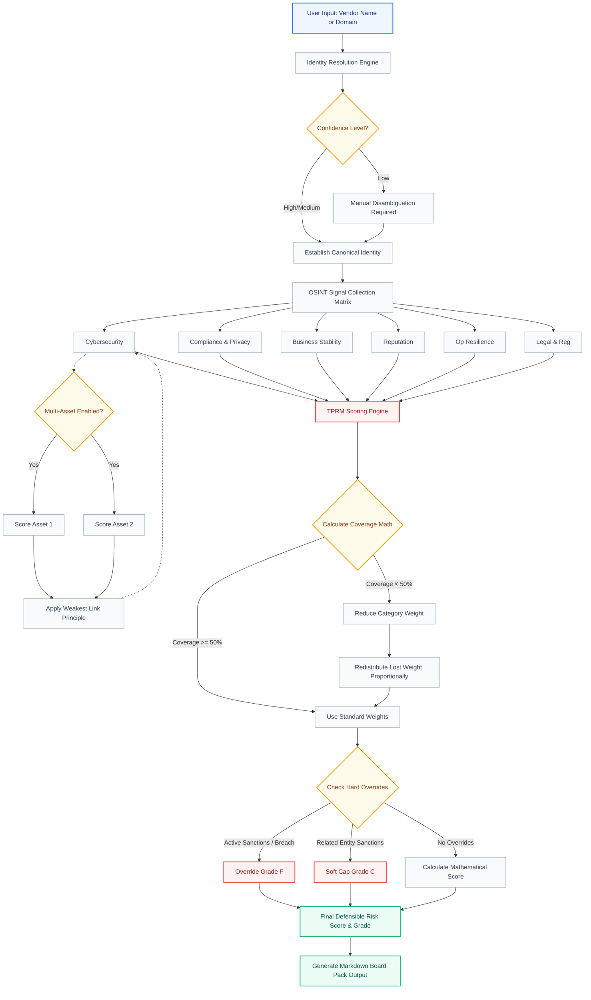

# Wahid AI TPRM Module - Demo Guide & Architecture Flow

This document provides a walkthrough of the TPRM Dashboard based on the `Effectiverm Inc.` demo scenario, explaining the data flow, architecture, and exact scoring mechanics observed.

## Demo Scenario: `effectiverm.com`
In this scenario, we evaluated a vendor with a pristine record except for two minor/medium operational and cybersecurity issues.

1. **Vendor Identity:** System resolved "Effectiverm Inc." to `effectiverm.com` with High confidence.
2. **Coverage:** All 6 categories had 100% coverage (all planned signals evaluated).
3. **Cybersecurity Findings:** 1 Low severity finding (Missing `security.txt` file). Score = 940 (-10 pts).
4. **Operational Resilience Findings:** 1 Medium severity finding. Score = 920 (-30 pts).
5. **Other Categories:** Pristine (950).
6. **Final Score:** 944 / 950 (Grade A).

### Mathematical Breakdown
Because all categories had >= 50% coverage, no weight redistribution occurred. The math strictly followed the base weights:
- **Cybersecurity (30%):** 940 * 0.30 = 282
- **Compliance (20%):** 950 * 0.20 = 190
- **Business Stability (15%):** 950 * 0.15 = 142.5
- **Reputation (15%):** 950 * 0.15 = 142.5
- **Operational Resilience (10%):** 920 * 0.10 = 92
- **Legal & Regulatory (10%):** 950 * 0.10 = 95
**Total:** 282 + 190 + 142.5 + 142.5 + 92 + 95 = 944

> **Note on OSINT Data Feeds:** In this Demo environment, the browser executes real live CORS-friendly queries (like Google Public DNS and ICANN RDAP). However, for APIs like RSS Feeds, BreachDB, or Shodan that block browser origins, the system uses a **Deterministic Domain Hash**. This intelligently generates highly realistic and consistent mock data based on the URL, allowing you to perfectly test the math and coverage models. To attach real API keys (e.g., NewsAPI, Qualys), a dedicated backend proxy must be established.

---

## Complete System Architecture & Data Flow Diagram

The following Mermaid flow diagram illustrates the complete end-to-end architecture of the Wahid AI TPRM Scoring Engine.

## How the Flow Matches the Dashboard
1. **Top Section:** The `Identity Resolution` establishes the base context.
2. **Left Column (Matrix):** Users interact with the `OSINT Signal Collection Matrix`, flagging findings across the 6 categories and optionally triggering the `Multi-Asset` evaluator.
3. **Right Column (Outputs):** Displays the outputs from the `TPRM Scoring Engine`:
   - The large **Scorecard** (Top Right)
   - The **Weight Redistribution Math Debugger** (Middle Right) showing the `Calculate Coverage Math` step.
   - The **Standardized Output Report** (Bottom Right) generated from the final outputs.
