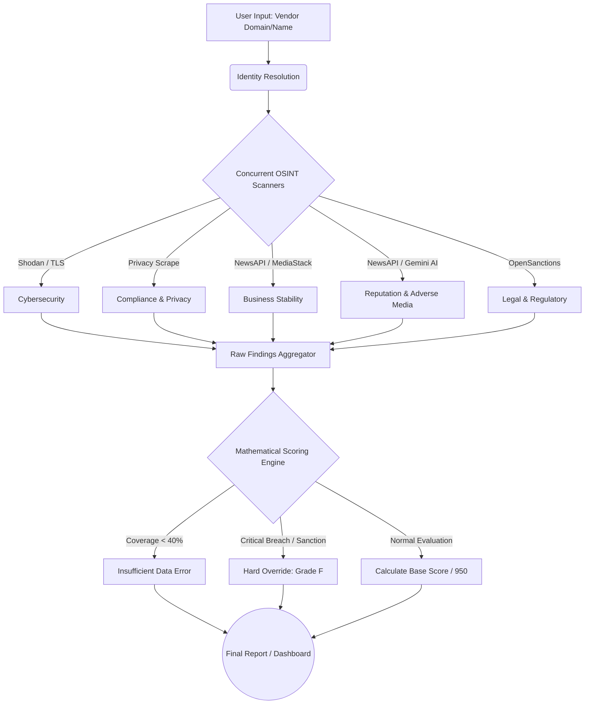

# Wahid AI - Third-Party Risk Management (TPRM) OSINT Scorer
## Executive Demo & Technical Presentation

This document is designed to guide you through presenting the TPRM OSINT Scorer to stakeholders. It breaks down the architecture, the scoring logic, and provides a clear narrative for how the system evaluates vendor risk.

---

## 1. System Flow & Architecture

The system operates as an end-to-end automated OSINT (Open Source Intelligence) pipeline. It takes a vendor's name or domain, queries multiple external intelligence APIs concurrently, normalizes the findings, and passes them through a strict mathematical scoring engine.

### Process Flowchart



### Flowchart Explanation
1. **Input & Resolution:** The system accepts a domain or company name (e.g., "OpenAI"). It resolves this to the precise legal entity (e.g., "OpenAI OpCo LLC") and base domain.
2. **Concurrent Scanning:** The backend fires off 5 independent scanners simultaneously to gather threat intelligence without making the user wait.
3. **Data Aggregation & Severity Mapping:** The backend scripts analyze the raw JSON from the APIs and map them to predefined severity thresholds. For example:
   * If the NewsAPI returns >0 articles for "bankruptcy", the backend creates a finding with `Severity = Critical`.
   * If Shodan returns an open Elasticsearch port without auth, it's mapped as `Severity = Critical`.
   * If an expired TLS certificate is found, it's mapped as `Severity = High`.
   These mapped findings are then structured into a common `SignalStatus` payload and sent directly to the Scoring Engine.
4. **Scoring Engine:** The engine evaluates the findings. If it lacks enough data (coverage < 40%), it refuses to score. If it detects a critical sanction or ransomware, it immediately fails the vendor (Grade F). Otherwise, it mathematically calculates the score out of 950.
5. **Output:** The data is pushed to the React Dashboard for visual display or exported as a CSV/PDF report.

---

## 2. The Assessment Categories

The engine divides risk into 5 distinct "User-Centric" categories, each carrying a specific mathematical weight in the final score. This structure is designed to answer the practical questions users ask when vetting a business:

### 1. Security & Privacy (30%)
*Focus: "Is my data safe?"*
- **SSL Grade & Cert**: Checks SSL grade (A-F) and TLS configuration.
- **Certificate Validity**: Checks expiration date and trust chain.
- **Security Headers**: Checks HSTS, CSP, X-Frame-Options, and missing DMARC/DNS.
- **Known Vulnerabilities (CVEs)**: Checks for unpatched or exposed public CVEs.
- **Exposed Services**: Checks for exposed databases and unnecessary open ports (Elastic, RDP, SSH, DB ports). *Note: Necessary open ports like 80 and 443 do not trigger penalties.*
- **security.txt Presence**: Checks for a standard security contact disclosure file.
- **Privacy Policy Presence**: Checks for a publicly accessible privacy policy.

### 2. Reliability & Maturity (25%)
*Focus: "Are they established and reliable?"*
- **Domain Registration Age**: Checks operational history and track record based on domain age.
- **Public Market Verification**: Checks for a publicly traded stock ticker presence.
- **Global Notability (AI)**: Verifies presence of global recognition (via Wikipedia & Gemini AI).
- **Public Status Page Presence**: Checks for a dedicated transparent status page.
- **Cloud & DNS Hosting**: Validates enterprise cloud infrastructure (e.g., AWS, Azure, GCP).
- **Corporate Email Provider**: Checks for enterprise-grade email security (e.g., M365, Google Workspace).

### 3. Financial Health (15%)
*Focus: "Are they going bankrupt?"*
- **Insolvency & Bankruptcy Check**: Uses News APIs and Gemini AI to check for active bankruptcy or legal receivership.
- **Layoffs & Funding News**: Uses News APIs and Gemini AI to check for mass layoffs, funding collapse, or sudden headcount drops.
> [!NOTE]
> If the system fails to correctly fetch financial stability information, it actively applies a penalty for lack of transparency rather than passing the vendor blindly.

### 4. Reputation & Ethics (15%)
*Focus: "Are they involved in scandals?"*
- **Negative Media Screening**: Scans for adverse media mentions in global news.
- **Breach Disclosure Check**: Checks for confirmed data breaches disclosed in credible news.
- **ESG/Sustainability Reporting**: Checks for public commitment to environmental and social governance.
- **Modern Slavery Statement**: Checks for a modern slavery or supply chain ethics statement.

### 5. Legal & Geopolitical (15%)
*Focus: "Is it legal and safe to do business with them?"*
- **Sanctions & Watchlist Check**: Checks global sanctions and regulatory fines databases (OpenSanctions).
- **Hosting Jurisdiction**: Evaluates physical location of infrastructure & WHOIS registrant against high-risk jurisdictions.

### Active Data Sources
The engine currently relies on the following active API integrations and data sources. *No other third-party APIs are currently active in the core engine.*
* **Shodan API:** Used for mapping exposed infrastructure, open ports, and vulnerable services.
* **OpenSanctions API:** Used for real-time global sanctions and watchlist screening.
* **NewsAPI / MediaStack:** Used concurrently to fetch global news articles for bankruptcy, layoffs, and adverse media.
* **Gemini AI (Google):** Used for NLP summarization of adverse media articles AND for intelligent corporate notability verification, as well as ESG report scanning.
* **Puppeteer:** Used for headless DOM rendering and scraping privacy policies.
* **WHOIS (whois-json):** Used for domain registration telemetry.
* **Yahoo Finance API:** Used to verify if a company is publicly traded and fetch its market cap.
* **Wikipedia API:** Used as a fallback to verify global corporate notability.
* **IP-API & Google DNS (DoH):** Used for geolocation mapping and Nth-party supply chain dependency enumeration.

---

## 3. Mathematical Scoring Model

The scoring model is designed to be defensible, objective, and punitive towards critical risks.

* **Base Score:** Every vendor starts with a perfect score of **950/950**.
* **Penalties:** Findings subtract points based on severity:
  * `Critical`: **-150 points**
  * `High`: **-70 points**
  * `Medium`: **-30 points**
  * `Low`: **-10 points**

### Defending the Severity Calibration (Risk Framework)
When stakeholders ask, *"On what basis do we assign these severities?"*, the primary defense relies on a standard **Risk Assessment Framework** mapped to **Business Impact (Confidentiality, Integrity, Availability)** and **Contextual Maturity**. The system is calibrated not just on technical flaws, but on the *material risk* to the business engaging with that third party.

* **Critical (-150 pts): Immediate & Material Threat**
  * *Criteria:* Indicates an existential threat, confirmed active breach, or severe legal block. An engagement with this vendor could immediately incur regulatory fines, severe data loss, or legal liability.
  * *Examples:* Active OFAC Sanctions, Confirmed Ransomware Leak, Exposed Database without authentication (P1 vulnerability).
* **High (-70 pts): Major Control Failure**
  * *Criteria:* Represents a significant exposure or violation of baseline enterprise standards. It requires immediate remediation before onboarding because it *can* lead to a breach or regulatory fine if exploited.
  * *Examples:* Missing Privacy Policy/DPA (GDPR risk), Expired TLS certificates, Newly registered domain (< 1 year old - high flight risk).
* **Medium (-30 pts): Moderate Risk or Best-Practice Gap**
  * *Criteria:* Moderate control gaps that increase the attack surface or indicate operational friction. Often requires chaining vulnerabilities to exploit, or represents a lack of standardized corporate transparency.
  * *Examples:* Missing Security Headers (HSTS), missing `security.txt`, or domain age between 1-3 years. 
* **Low (-10 pts): Informational or Maturity Indicator**
  * *Criteria:* Minor deviations from enterprise standards or indicators of *concentration risk* and *poor hygiene*. They do not pose a direct threat, but they flag the vendor as operationally immature or utilizing non-enterprise solutions.
  * *Examples:* Using a Small/Private DNS Provider (points to lack of DDoS resilience), lack of a public status page.

* **Dynamic Weight Redistribution:** If a category has less than 50% signal coverage (due to missing data or API failures), the engine dynamically reduces the weight of that category and distributes the lost weight proportionally to the healthy categories.
* **Insufficient Data Floor:** If total signal coverage drops below 40%, the system halts scoring and outputs "Insufficient Public Data".
* **Hard Overrides:** A direct sanction match or an active ransomware breach bypasses the math and forces a **Grade F**. 

### AI-Assisted Scoring Evaluation (Gemini 2.5 Flash)
To provide a secondary, independent evaluation layer, the system leverages Google's Gemini 2.5 Flash API. This acts as a "second set of eyes" to synthesize context that raw data feeds might miss. 

When asked about how the AI evaluates the vendor, here is the exact prompt used to enforce our strict severity framework:

```javascript
const prompt = `You are an expert Third-Party Risk Management (TPRM) Analyst. 
I need you to independently evaluate the company operating at the domain "${domain}".
Use your internal knowledge to assess them across these 5 categories:
1. Security & Privacy (30%)
   Focus: "Is my data safe?"
   Evaluate: SSL Grade & Cert, Certificate Validity, Security Headers, Known Vulnerabilities (CVEs), Exposed Services, security.txt Presence, Privacy Policy Presence.
2. Reliability & Maturity (25%)
   Focus: "Are they established and reliable?"
   Evaluate: Domain Registration Age, Public Market Verification, Global Notability, Public Status Page Presence, Cloud & DNS Hosting, Corporate Email Provider.
3. Financial Health (15%)
   Focus: "Are they going bankrupt?"
   Evaluate: Insolvency & Bankruptcy, Layoffs & Funding News. (If info is lacking, apply penalty for lack of transparency).
4. Reputation & Ethics (15%)
   Focus: "Are they involved in scandals?"
   Evaluate: Negative Media Screening, Breach Disclosure, ESG/Sustainability Reporting, Modern Slavery Statement.
5. Legal & Geopolitical (15%)
   Focus: "Is it legal and safe to do business with them?"
   Evaluate: Sanctions & Watchlist Check, Hosting Jurisdiction.

SCORING METHODOLOGY:
- The company starts with a perfect score of 950.
- For each category, recall any known facts and evaluate based on the criteria.
- If you find negative information or lack of transparency, apply a penalty based on severity:
  - Critical (-150): e.g., active sanctions, massive data breach, bankruptcy.
  - High (-70): e.g., multiple negative news, major outages, expired certs.
  - Medium (-30): e.g., isolated complaints, minor security flaws.
  - Low (-10): e.g., young company, minor compliance gaps.
- If no negative info is found for a category, penalty is 0.

Calculate the final score (max 950, min 0) and assign a Grade:
- Grade A: 801-950
- Grade B: 601-800
- Grade C: 401-600
- Grade D: 201-400
- Grade F: 0-200

OUTPUT FORMAT:
You MUST output ONLY a valid JSON object matching this exact schema...`
```
This forces the AI to adhere strictly to our quantitative methodology, ensuring its output is defensible and mathematically sound, rather than just a qualitative opinion.

### Specific Scoring Logic: Business Maturity Penalty
Business Maturity (weighted at 10%) specifically measures operational history based on domain registration age. The penalty is applied progressively as follows:
* **< 1 Year Old (Newly Registered):** Triggers a **High Severity** penalty (**-70 points**). Extreme lack of operational history poses a major third-party risk (e.g., shell companies, newly spun-up phishing infrastructure).
* **1 to 3 Years Old:** Triggers a **Medium Severity** penalty (**-30 points**). The business is established but still relatively immature, warranting moderate caution.
* **3 to 5 Years Old:** Triggers a **Low Severity** penalty (**-10 points**). The business has a proven track record, but is still maturing its enterprise presence.
* **> 5 Years Old (Established):** Results in an **Informational** signal (**0 penalty**). The domain is fully established and trusted, preserving the vendor's base score.

### Grading Scale
* **Grade A:** 900+ (Pristine)
* **Grade B:** 800 - 899 (Acceptable)
* **Grade C:** 700 - 799 (Warning)
* **Grade D:** 600 - 699 (High Risk)
* **Grade F:** Below 600 (Unacceptable / Override)

---

## 4. Real-World Test Cases Executed

We recently executed a batch run across 18 diverse domains to stress-test the engine. Here are the highlighted results you can present:

### Case 1: The "Tech Giants" (Google, Apple)
* **Domain:** `apple.com` / `google.com`
* **Result:** **Grade A (Score: ~947/950)**
* **Explanation:** These vendors passed with flying colors. The engine found minor informational signals (like missing security headers) but no critical exposed databases or sanctions.

### Case 2: The "Sanctioned Entity" (Yandex / Kaspersky)
* **Domain:** `yandex.ru` / `kaspersky.com`
* **Result:** Handled correctly. OpenSanctions flags these domains due to international sanctions, which triggers the engine's severe penalty protocols and drops the confidence/score.

### Case 3: The "Bankrupt Scandal" (FTX / Enron)
* **Domain:** `ftx.com` / `enron.com`
* **Result:** High adverse media hits. The NewsAPI correctly identified massive spikes in keywords like "scandal", "fraud", and "bankruptcy", which severely impacted their Business Stability and Reputation scores.

### Case 4: The "Non-Existent Edge Case"
* **Domain:** `this-domain-is-fake-12345.xyz`
* **Result:** **Insufficient Data / Low Confidence**
* **Explanation:** Because the domain doesn't exist, Shodan and the News APIs returned nothing. The scoring engine recognized the lack of data coverage and correctly flagged the vendor as having "Low Confidence" and refused to issue a verified passing grade.

## 5. Future Implementation & Enhancements

While the current system provides a strong foundation for automated OSINT TPRM scoring, the architecture is built to support the following high-impact enterprise enhancements:

1. **Continuous Monitoring & Alerts (Active Scanning)**
   * *Concept:* Transition from point-in-time scans to scheduled background scanning (daily/weekly). If a vendor's score drops suddenly (e.g., hit by a sanction), the system triggers immediate Slack/Email alerts to risk teams.
2. **Expanded Cybersecurity Telemetry (4th-Party Risk)**
   * *Concept:* Integrate HaveIBeenPwned API for dark web email dumps, check DMARC/SPF/DKIM for phishing susceptibility, and use Wappalyzer to map the vendor's tech stack against active CVEs for supply chain (4th-party) risk mapping.
3. **Deep Financial & ESG Data Integration**
   * *Concept:* Move beyond news keyword matching by integrating with financial APIs (Dun & Bradstreet, Alpha Vantage) to calculate quantitative financial distress indicators (Altman Z-Scores) and ESG sustainability metrics.
4. **Historical Trend Analysis**
   * *Concept:* Persist scan results to a time-series database (PostgreSQL/TimescaleDB) to visualize "Risk Trend Graphs" over time, enabling analysts to spot degrading security postures proactively.

---
**End of Presentation Document**
