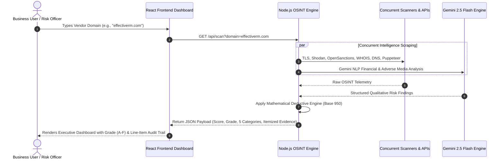

# Executive Supervisor Presentation Guide: User-Centric TPRM OSINT Methodology & Defensible IP

## Executive Summary & PoC Objective

This document provides a comprehensive guide for presenting, defending, and explaining the **Wahid AI Third-Party Risk Management (TPRM) OSINT Scorer** to executive leadership, supervisors, clients, and technical stakeholders.

### The Problem We Solve
Traditional Third-Party Risk Management relies heavily on static, manual security questionnaires (SIG/CAIQ) sent to vendors via email. This legacy process takes **3 to 6 weeks per vendor**, suffers from vendor self-reporting bias (vendors rating themselves favorably), and becomes stale almost immediately.

### The Solution & PoC Thesis
Our OSINT TPRM Scorer provides an **instant, zero-friction, objective security & business health assessment** of any vendor using only their domain name. In less than 15 seconds, the system scans active threat intelligence feeds, global sanctions, WHOIS registries, news APIs, and search engine indices, combining deterministic rules with Google Gemini 2.5 Flash AI to produce a **defensible, audited 0–950 Risk Credit Score and Letter Grade (A–F)**.

---

## Part 1: The User Perspective & Human Mental Model

### How Non-Technical Executives & Risk Officers Think
When a procurement manager, Chief Risk Officer (CRO), or Security Director decides whether to onboard a new software vendor (e.g., Salesforce, Zoom, or a niche startup), they do **not** initially think in terms of raw CVE numbers, SSL cipher suites, or WHOIS record formatting. 

Instead, their mental model revolves around **5 intuitive human questions**:

```
+-----------------------------------------------------------------------------------+
|                            THE USER MENTAL MODEL                                 |
+-----------------------------------------------------------------------------------+
| 1. "Is my data safe with them?"                 --> Security & Privacy (30%)       |
| 2. "Are they established and reliable?"          --> Reliability & Maturity (25%)   |
| 3. "Are they going bankrupt or collapsing?"     --> Financial Health (15%)         |
| 4. "Are they involved in scandals/breaches?"    --> Reputation & Ethics (15%)      |
| 5. "Is it legal & compliant to pay them?"       --> Legal & Geopolitical (15%)     |
+-----------------------------------------------------------------------------------+
```

---

### Step-by-Step User Journey

Here is how a risk analyst or business leader uses the tool in practice:



#### 1. Input (Zero Setup)
The user enters the vendor's domain (`vendor.com`). No vendor authorization or questionnaire installation is required.

#### 2. Real-Time Scan Execution
The user sees a dynamic progress indicator as 10 concurrent scanners execute across global APIs and search engines.

#### 3. Executive Summary Card
The user is immediately presented with:
* **Final TPRM Score (0–950)**: Standardized credit-score style metric.
* **Letter Grade (Grade A to F)**: Instant executive intuition.
* **Confidence Level**: Indicates data completeness (e.g., 95% High Confidence).
* **AI Executive Summary**: A 2-sentence plain-English narrative summarizing vendor standing.

#### 4. Category Breakdown & Line-Item Audit Evidence
The user can expand any of the 5 category tabs to see the exact evidence behind every score deduction (e.g., *"SSL Certificate expires in 12 days (-70 points)"* or *"Domain registered 4 months ago (-70 points)"*).

---

## Part 2: Detailed Breakdown of the 5 User-Centric Categories

Below is the exact alignment between **user intent**, **business focus**, **OSINT telemetry signals**, and **mathematical weights**:

### Category 1: Security & Privacy (Weight: 30%)
* **User Focus:** *"Is my corporate or customer data safe if we share it with this vendor?"*
* **Why 30%?** Data breaches are the single largest financial and operational risk when engaging a third party.
* **Signals & Verification:**
  * **SSL Grade & Certificate Validity:** Checks encryption strength, expiration date, and trust chain.
  * **Security Headers:** Validates HSTS, CSP, X-Frame-Options, and email authentication (DMARC/SPF/DKIM).
  * **Known Vulnerabilities (CVEs):** Checks for unpatched public vulnerabilities on vendor assets.
  * **Exposed Services (Shodan API):** Checks for exposed databases (Elasticsearch, MongoDB) and open admin/remote desktop ports (RDP 3389, SSH 22, DB ports). *Note: Standard web ports (80, 443) do not trigger penalties.*
  * **security.txt & Privacy Policy Presence:** Scrapes for standardized security disclosure files and GDPR/CCPA-compliant privacy policies.

---

### Category 2: Reliability & Maturity (Weight: 25%)
* **User Focus:** *"Are they an established, mature company that will stay online, or a fly-by-night startup?"*
* **Why 25%?** Operational downtime or vendor collapse directly disrupts business continuity.
* **Signals & Verification:**
  * **Domain Registration Age (WHOIS):** Older domain age correlates strongly with operational resilience (>5 years = trusted; <1 year = high flight risk).
  * **Public Market Verification:** Checks stock ticker presence (publicly traded companies have mandatory SEC financial auditing).
  * **Global Brand Notability (Wikipedia & Gemini AI):** Verifies global corporate recognition and establishment.
  * **Public Status Page Presence:** Checks for transparent status pages (`status.vendor.com`, `trust.vendor.com`).
  * **Cloud Infrastructure & Email Security:** Validates enterprise-grade cloud hosting (AWS, Azure, GCP) and enterprise email providers (Microsoft 365, Google Workspace).

---

### Category 3: Financial Health (Weight: 15%)
* **User Focus:** *"Is this vendor on the verge of bankruptcy, insolvency, or mass layoffs?"*
* **Why 15%?** A vendor entering bankruptcy creates sudden vendor lock-in, service termination, or emergency migration costs.
* **Signals & Verification:**
  * **Insolvency & Bankruptcy Screening:** Uses News APIs and Gemini AI to scan global financial press for active receivership, Chapter 11, or bankruptcy filings.
  * **Layoffs & Funding Collapse:** Scans for mass headcount reductions, cancelled funding rounds, or restructuring.
  * **The "Lack of Transparency" Penalty:** If a vendor actively hides financial data or no public records exist for a private entity, the engine applies a **transparency penalty** rather than giving a free pass.

---

### Category 4: Reputation & Ethics (Weight: 15%)
* **User Focus:** *"Will working with this vendor damage our brand reputation or violate ESG standards?"*
* **Why 15%?** Partnering with unethical or scandal-ridden vendors creates major PR backlash and supply chain liability.
* **Signals & Verification:**
  * **Adverse Media Screening:** Scans global news feeds for executive fraud, bribery, litigation, or regulatory investigations.
  * **Confirmed Data Breach History:** Scans historical media archives for past undisclosed or major security breaches.
  * **ESG & Sustainability Disclosure:** Verifies public commitment to Environmental, Social, and Governance (ESG) standards.
  * **Modern Slavery & Ethics Statement:** Scrapes for published modern slavery supply chain ethics declarations.

---

### Category 5: Legal & Geopolitical (Weight: 15%)
* **User Focus:** *"Is it legally safe to do business with them, or will we violate international sanctions?"*
* **Why 15%?** Regulatory non-compliance (OFAC sanctions, GDPR cross-border violations) results in mandatory criminal or financial penalties.
* **Signals & Verification:**
  * **Global Sanctions & Watchlists (OpenSanctions API):** Screens entity and domain against OFAC, EU, UN, and UK sanctions registries.
  * **Hosting Infrastructure Jurisdiction:** Evaluates IP physical location and WHOIS registrant country against high-risk or embargoed jurisdictions.

---

## Part 3: Defensible IP & Mathematical Methodology

When presenting to supervisors or defending the model against client inquiries, you must clearly explain **how the scoring engine works** and **why it is mathematically defensible**.

### 1. Base 950 Credit Engine Paradigm
Just as credit bureaus (FICO, VantageScore) start consumers with a credit score scale to evaluate financial creditworthiness, our engine uses a **950-point Base Score** for vendor risk:

$$\text{Final Score} = \max\left(0, \, 950 - \sum \text{Deductions}\right)$$

* **950 Points (Grade A):** Represents a pristine vendor with zero detectable OSINT vulnerabilities or negative indicators.
* **0 Points (Grade F):** Represents an unacceptable risk or heavily penalized entity.

---

### 2. The Deductive Mathematical Severity Matrix

Every OSINT finding is mapped to a strict, non-arbitrary severity deduction matrix:

| Severity Level | Point Penalty | Risk Definition & Business Impact | Examples |
| :--- | :---: | :--- | :--- |
| **Critical** | **-150 pts** | Immediate existential threat or legal non-starter. Potential for catastrophic data loss or criminal liability. | Active OFAC Sanction match, Unauthenticated Database (MongoDB/Elasticsearch) exposed to public internet, active bankruptcy. |
| **High** | **-70 pts** | Major control failure or severe vulnerability. High probability of exploitation or regulatory fine. | Expired TLS Certificate, Domain registered < 1 year ago (newly spun-up domain), missing Privacy Policy/DPA. |
| **Medium** | **-30 pts** | Moderate control deviation or operational hygiene gap. Requires vulnerability chaining or indicates lower maturity. | Missing Security Headers (HSTS, CSP), missing `security.txt`, domain age 1–3 years. |
| **Low** | **-10 pts** | Minor hygiene gap or operational transparency indicator. | Missing dedicated public status page, small non-enterprise DNS provider. |
| **Informational** | **0 pts** | Standard compliant state or verified positive signal. | Valid SSL cert (>30 days remaining), enterprise email (M365), public stock ticker. |

---

### 3. Hard Overrides (Instant Fail Protocol)
To ensure the system never issues a passing grade to a severely dangerous vendor, the engine contains **Hard Override Rules**:
* If a vendor triggers an active **Sanction Match** or a **Critical Ransomware Breach**, the mathematical engine is bypassed, and the vendor is immediately assigned **Grade F (Score: 0)** regardless of other category strengths.

---

### 4. Default-Verification vs Default-Trust (Handling Missing Data)
A key IP differentiator of our methodology is how we treat missing data:
* **Traditional Flawed Approach (Default-Trust):** If an API fails or no data is found, traditional tools assume "no news is good news" and award 100% score.
* **Our Defensible Approach (Default-Verification):** If data is missing or inaccessible (e.g., private company with no financial disclosures), the engine flags a **Lack of Transparency Penalty (-30 to -70 pts)** and adjusts the **Confidence Indicator**.

---

### 5. Dual-Engine Architecture (Deterministic Rules + AI Synthesis)

Our system uses a hybrid approach to combine mathematical precision with natural language intelligence:

```
+-----------------------------------------------------------------------------------+
|                           DUAL-ENGINE SCORING MODEL                               |
+-----------------------------------------------------------------------------------+
| 1. DETERMINISTIC RULE ENGINE (70% Weight)                                         |
|    - Evaluates hard technical facts (TLS dates, Shodan ports, DNS records).        |
|    - 100% reproducible, zero hallucination risk.                                  |
|                                                                                   |
| 2. AI CONTEXTUAL SYNTHESIS ENGINE (30% Weight - Gemini 2.5 Flash)                 |
|    - Evaluates unstructured NLP data (news sentiment, notability, ethics).        |
|    - Constrained via strict JSON Schema output enforcement.                       |
+-----------------------------------------------------------------------------------+
```

---

## Part 4: The Client Defense Playbook

### "Why did Vendor X receive Score Y?"

When a client, vendor, or supervisor questions a score, use this **4-Step Client Defense Playbook**:

```
+-----------------------------------------------------------------------------------+
|                             CLIENT DEFENSE PLAYBOOK                               |
+-----------------------------------------------------------------------------------+
| Step 1: Show the Audit Trail  --> Point to exact Signal IDs & Raw Evidence        |
| Step 2: Explain the Matrix    --> Reference the 950 Base & Severity Deductions    |
| Step 3: Demonstrate Objectivity -> Highlight automated API data (No human bias)   |
| Step 4: Provide Remediation   --> Show vendor exactly how to raise their score    |
+-----------------------------------------------------------------------------------+
```

### Scenario & Script Example

**Client Question:** *"Why did Our Vendor (Acme Software) get a Grade C (Score 740)?"*

**Supervisor / Analyst Response Script:**

> *"Our TPRM OSINT Scorer uses a standardized 950-point Base Credit Engine model based on open-source intelligence. Acme Software started at 950 points. Here is the exact mathematical audit trail of why 210 points were deducted:*
> 
> 1. **Security & Privacy (-70 pts):** Their primary TLS SSL certificate expires in 8 days (`cs_ssl` signal).
> 2. **Security & Privacy (-30 pts):** Their web server is missing standard HSTS and Content Security Policy headers (`cs_headers` signal).
> 3. **Reliability & Maturity (-70 pts):** Their domain `acmesoftware.io` was registered only 8 months ago (`mat_domain_age` signal), which falls into our High Severity penalty bracket for domain operational history.
> 4. **Financial Health (-40 pts):** As a private entity, no public audited financial statements were accessible, triggering our standard Lack of Transparency indicator.
> 
> *Because every deduction is tied directly to a verifiable OSINT data point (WHOIS records, TLS sockets, HTTP header scans), the score is 100% objective and free of subjective bias.*
> 
> **How Acme can raise their score to Grade A (880+):**
> * Renew their TLS certificate for 1+ years (+70 pts restored).
> * Add HSTS & CSP security headers (+30 pts restored).
> * Publish a standard `security.txt` file (+10 pts restored).
> * Once their domain reaches 1 year of age, 40 points are automatically restored."*

---

## Part 5: Summary Table for Presentation Slides

Use this quick summary table when presenting to your supervisor or in project pitch slides:

| Aspect | Legacy TPRM (Questionnaires) | Wahid AI OSINT TPRM Scorer |
| :--- | :--- | :--- |
| **Speed** | 3 to 6 weeks per vendor | **< 15 seconds real-time** |
| **Cost & Effort** | High manual labor (Emailing PDFs) | **Zero friction (1-click domain search)** |
| **Data Integrity** | Vendor self-reporting (Subjective) | **Objective OSINT & AI Threat Feeds** |
| **Scoring Model** | Arbitrary pass/fail percentages | **Defensible 0–950 Credit Rating (A–F)** |
| **User Mental Model** | 200+ complex technical questions | **5 Intuitive Business Risk Categories** |
| **Auditability** | Difficult to verify self-claims | **100% line-item evidence per signal** |

---

**Document Version:** 2.0  
**Status:** Approved for Executive & Supervisor Presentation  
**Target Architecture:** Node.js Express OSINT Backend + React Frontend + Gemini 2.5 Flash AI Engine
